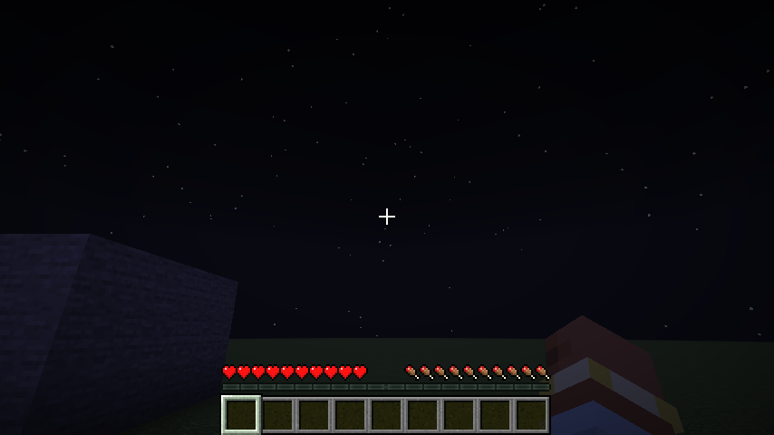
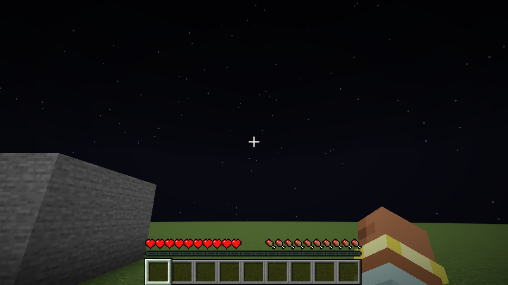
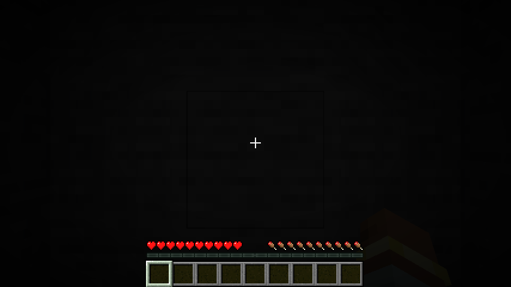
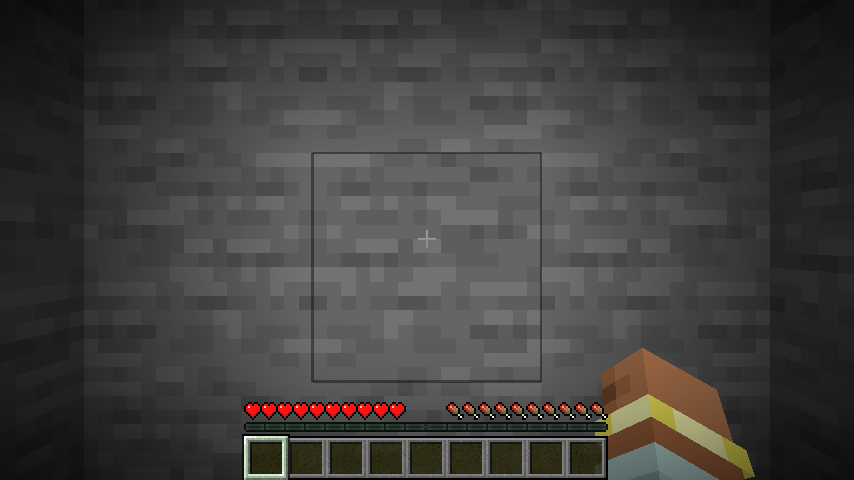
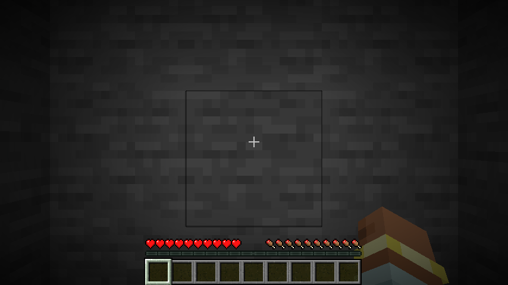
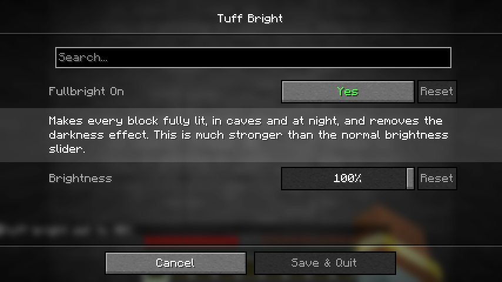

# Tuff Bright

fullbright that actually works. every block is fully lit, in caves and at night, and the darkness effect is gone. it is a lot stronger than the normal brightness slider.

client side fabric mod. settings with the menu (key **C** or mod menu, 1.21.11 jar needs [Wysss Library](https://github.com/realwysss/Wysss-Library)), or with the command `/tuffbright 0-100` (1.21.11), or switch it on and off with the key **B** (rebind it in Controls). needs fabric api:

- **fullbright on**: turn it off for the normal game lighting
- **brightness**: slider from 0% to 100%. 100% (default) lights everything like full daylight. every step in between is a visible step (cave: 15% a little, 30% a bit more, 50% half way). 0% does nothing

## downloads

| jar | minecraft |
|---|---|
| `tuff-bright-mc1.21.11-1.3.0.jar` | 1.21.11 |
| `tuff-bright-mc26.1-26.3-1.2.0.jar` | 26.1 to 26.3 |

## pictures

same spot, same time, mod off and on:

| off | on |
|---|---|
|  |  |
|  |  |

50% in a cave and the settings screen:

## how it works

one mixin on the lightmap. on 1.21.11 it raises the brightness value that goes into the lightmap shader (and zeroes the darkness values), on 26.x it does the same on the lightmap render state. the brightness is far above the normal slider max, so even light level 0 ends up fully lit.

all rights reserved. made by wysss.
